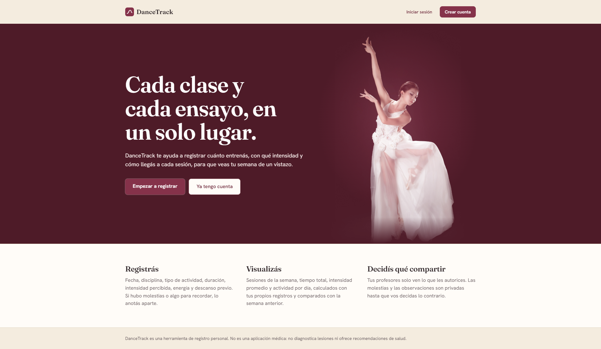
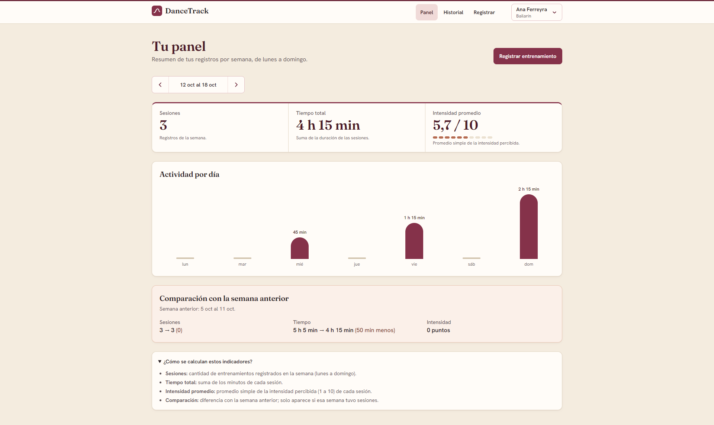
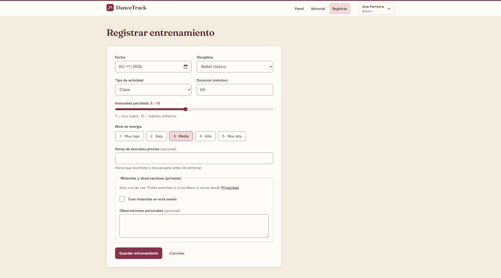
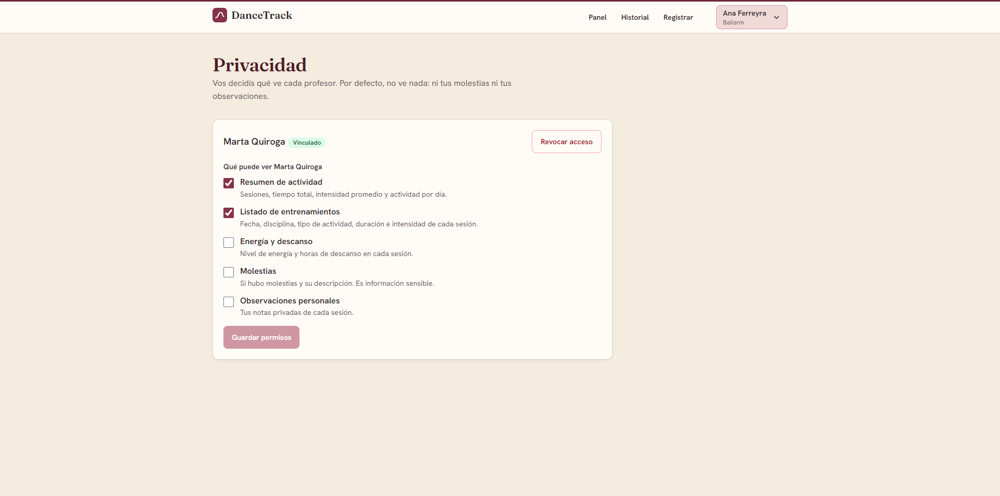

# DanceTrack 💃

**Aplicación web para el registro y seguimiento de entrenamientos de danza.**

DanceTrack permite a bailarines y bailarinas registrar sus sesiones de entrenamiento, consultar su actividad y realizar un seguimiento de su evolución.

También incorpora un sistema de vinculación entre profesores y bailarines, donde el acceso a la información depende de los permisos otorgados por cada usuario.

<https://dancetrack-app.vercel.app>

---

## Funcionalidades

### Bailarines

- Registro e inicio de sesión.
- Registro de entrenamientos por disciplina y tipo de actividad.
- Seguimiento de duración, intensidad, energía, descanso y molestias.
- Historial de entrenamientos.
- Dashboard con resúmenes y métricas de actividad.
- Gestión del perfil y de los permisos de privacidad.

### Profesores

- Consulta de bailarines vinculados y que aceptaron la relación.
- Acceso a información compartida por cada bailarín.
- Visualización condicionada por permisos individuales.

### Administradores

- Gestión de usuarios y roles.
- Activación y desactivación de cuentas.
- Administración de disciplinas.
- Gestión de vínculos entre profesores y bailarines.

## Tecnologías

| Área                        | Tecnologías                    |
| --------------------------- | ------------------------------ |
| Frontend                    | React 19, TypeScript, Vite     |
| Estilos                     | Tailwind CSS 4                 |
| Navegación                  | React Router DOM 7             |
| Backend                     | Node.js, Express 5, TypeScript |
| Base de datos               | PostgreSQL                     |
| ORM                         | Prisma 6                       |
| Validación                  | Zod                            |
| Autenticación               | JWT y cookies `httpOnly`       |
| Pruebas                     | Vitest y Supertest             |
| Frontend en producción      | Vercel                         |
| Backend en producción       | Render                         |
| Base de datos en producción | Neon                           |

## Arquitectura

El sistema utiliza una arquitectura cliente-servidor:

- **Frontend:** gestiona la interfaz y las interacciones con los usuarios.
- **Backend:** expone una API REST que procesa solicitudes, valida datos y controla la autenticación y autorización.
- **Base de datos:** PostgreSQL, administrada mediante Prisma ORM.

El frontend se comunica exclusivamente con la API REST. No accede directamente a la base de datos.

## Capturas de pantalla

### Página principal



### Dashboard



### Registro de entrenamientos



### Privacidad y permisos



## Demo

**Aplicación:** https://dancetrack-app.vercel.app

## Instalación local

### Requisitos

- Node.js 22 o compatible con las dependencias del proyecto.
- npm.
- PostgreSQL.

### 1. Clonar el repositorio

```bash
git clone https://github.com/Melisa8181/dancetrack.git
cd dancetrack
```

### 2. Configurar el backend

```bash
cd backend
npm install
```

Crear un archivo `.env` a partir de `.env.example`.

Configurar las siguientes variables:

| Variable            | Descripción                                   |
| ------------------- | --------------------------------------------- |
| `NODE_ENV`          | Entorno de ejecución                          |
| `PORT`              | Puerto del servidor                           |
| `DATABASE_URL`      | Conexión a PostgreSQL                         |
| `TEST_DATABASE_URL` | Base de datos independiente para pruebas      |
| `JWT_SECRET`        | Secreto para firmar las sesiones              |
| `CLIENT_ORIGIN`     | Origen autorizado del frontend                |
| `APP_TIMEZONE`      | Zona horaria de la aplicación                 |
| `DEMO_PASSWORD`     | Contraseña de las cuentas creadas por el seed |

Crear previamente las bases de datos en PostgreSQL. La base de pruebas debe ser independiente de la principal.

Aplicar las migraciones y generar el cliente de Prisma:

```bash
npm run prisma:deploy
npm run prisma:generate
```

Para cargar los datos iniciales de demostración en una base nueva:

```bash
npm run db:seed
```

Iniciar el backend:

```bash
npm run dev
```

### 3. Configurar el frontend

Abrir otra terminal y regresar a la carpeta raíz:

```bash
cd frontend
npm install
```

El archivo `.env` del frontend es opcional en desarrollo. La aplicación utiliza `/api` como configuración predeterminada.

Para iniciar el frontend:

```bash
npm run dev
```

Vite mostrará la dirección local para acceder a la aplicación.

### 4. Ejecutar las pruebas

Desde la carpeta `backend`:

```bash
npm test
```

Para verificar los tipos:

```bash
npm run typecheck
```

Para compilar el backend:

```bash
npm run build
```

Desde la carpeta `frontend`, para compilar la aplicación:

```bash
npm run build
```

**Importante:** no utilizar la base de producción para ejecutar pruebas. Tampoco ejecutar el seed sobre una base existente sin revisar previamente su comportamiento.

## Documentación adicional

- [Arquitectura y decisiones técnicas](docs/ARQUITECTURA.md)
- [Documentación de la API](docs/API.md)
- [Pruebas y limitaciones](docs/PRUEBAS.md)

## Estado del proyecto

Proyecto académico desarrollado en el marco de la Tecnicatura Superior en Desarrollo de Software del ISFT 204.

La aplicación cuenta con autenticación, gestión de roles y permisos, registro de entrenamientos, seguimiento de actividad y despliegue en producción.

## Autora

**Melisa Segura**
